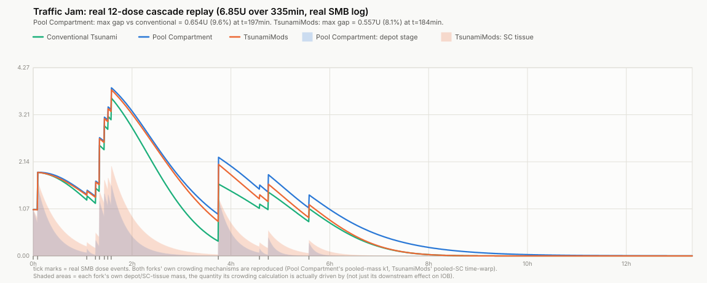

# Traffic Jam insulin model (this fork: Pool Compartment)

This is the "Lyumjev U100 (Tsunami Traffic Jam)" insulin model, built around one idea: insulin sitting under the skin doesn't all absorb at the same fixed speed. The more of it there is, the slower it is absorbed, and a new dose slows the absorption of all insulin still waiting, not just its own. Fitted to serum insulin from two pump studies, that happens above about 5U under the skin: below that the site absorbs at one top speed whatever it holds, so SMBs and basal don't slow each other.

There's another implementation of this idea on branch `AAPS_dev_TsunamiMods` (one curve
per dose, rather than the shared tanks below) — see its own README. The present method tackles the problem of activity curve's discontinuity: here activity never jumps, neither when a dose is given nor when the rates are re-evaluated (see below).

Traffic Jam is inspired by piecycle's Tsunami PD model (https://github.com/piecycle/tsunami), which adapts the absorption rate based solely on the individual dose. This branch started as an expansion of that model, but the target curve itself has since changed: the absorption constants are fitted to serum insulin from two pump studies, not to clamp activity curves, and the effect stage comes from a study that measured serum insulin and blood glucose together after correction boluses (see "Absorption rates and the fit"). On a settled pump site the depot's half-life is 10.2 minutes with up to 5U in it, so most of a dose's timing comes from its time in the blood (half-life 50.9 minutes); the delay to its effect is short (2.5 minutes), and crowding slows only boluses of more than 5U, by minutes. A lone 1U bolus's activity peaks at 44 minutes with the default 8-minute CGM lag (34 without), and 1 - IOB/dose reaches 0.9 after 198 minutes (189 without).

## How it works

Every dose (bolus, extended bolus, temp basal delivery) moves through three stages: the **depot**
(under the skin at the infusion site, not yet absorbed), **plasma** (insulin in the blood) and
**effect** (insulin effect still to come), and with a CGM lag set (the default) a fourth, the effect
the CGM has yet to show. A dose adds straight into the depot and moves down the chain; a bolus or
SMB enters as the pump gives it, in small pulses (see "Micro-doses"). Reported IOB is whatever's
left across all stages; reported activity is the rate at which the last stage empties.

Only the depot crowds: above about 5U, the more insulin sits in it, the slower it empties. Plasma
(half-life 50.9 minutes) and effect (half-life 2.5 minutes) are the body's and drain at fixed rates
that nothing changes, not even the speed setting. The depot's rate is re-evaluated at every whole
minute and right after every bolus (at the bolus's site), from the insulin then in the depot, and held
in between. Boluses, SMBs, extended boluses and delivered basal (the profile rate, temp basals and
zero temps alike) crowd each other once the depot holds more than that: a large bolus slows every
earlier dose still in the depot, and the insulin already there slows the bolus. Crowding stays within
one infusion site: insulin given before a cannula/site change never crowds insulin given after it. How
strongly doses crowd each other is a setting, the dose interaction (see "Dose interaction" below); at
its default of 1 they all share one rate, as described here. With the fitted constants (below) the
depot's rate on a settled site is 0.0683 per minute (half-life 10.2 minutes) with anything up to 5.0U
in the depot, 0.0471 with 10U (14.7 minutes) and 0.0323 with 20U (21.5 minutes). SMBs and basal alone
seldom bring it near 5U (the 12-SMB cascade further below holds at most 2.1U), so they absorb at the
top rate and slow nothing.

A new infusion site absorbs more slowly: at the new-site speed (0.48 by default) right after the
change, rising to full speed over the new-site ramp, 48 hours by default (see "Site age" below).

A new dose goes into the depot, and the depot's rate is re-evaluated right after it with the dose
included, so from then on, above 5U, it slows insulin still in the depot. The dose adds nothing to the
later stages, whose rates are fixed, so the reported activity never jumps, neither when a dose is
given nor when the depot's rate is re-evaluated. Nor does a dose ever lower it: whatever it slows,
more leaves the depot at every later moment than without it (8U, then 4U a quarter of an hour later,
never gives less activity than the 8U alone; Python replica of the engine).

Profile basal (the true baseline, evaluated as if nothing else was happening) is tracked independently as usual, following the same mechanism among its own doses only: each minute of profile basal interacts with the rest of the profile basal by the dose interaction value (see below), never with delivered insulin, so with no temp basal and no other insulin running it evolves identically to delivered basal, and it is the same every day for the same profile. The IOB the loop uses (bolus IOB + net basal IOB) is total IOB minus profile basal IOB, where total IOB is all insulin on board at the site (boluses, SMBs, extended boluses and delivered basal), computed every minute as above. Above a dose interaction of 0, boluses, SMBs and extended boluses that take the depot above 5U also slow the delivered basal; the basal they hold back is part of total IOB, and AAPS shows it under net basal IOB even with no temp running. The zero-temp IOB used for the zero-temp prediction is the same difference from a run with delivered basal stopped one minute from now, IOB and activity both.

## Absorption rates and the fit

The depot's rate law and the plasma stage are fitted to serum insulin lispro after pump boluses of
Lyumjev in two studies, all six curves together, each study's mean curves digitized from its figures:

- the pump study in the EMA's Lyumjev assessment report (EMA/86760/2020, study ITSC, figures 17 and
  18): a breakfast bolus on a MiniMed 640G with the basal running, on day 1 and day 3 of one 3-day
  infusion set, as a single-wave bolus (1.5 U/min) and a dual-wave one (half at 1.5 U/min, half over
  3 hours);
- Leohr et al. (Diabetes Obes Metab 2024;26:215), the Lyumjev arm, on MiniMed 640G pumps: a 7.4U
  bolus (the paper's geometric mean) with the basal running on day 1 of a treatment period, and the
  fall of serum insulin after the basal was suspended on day 2.

The pump's delivery is replayed as it was given: boluses in 0.05U pulses, a minute of pulses at a
time, and the basal and the square wave a dose a minute, all of it in one depot (dose interaction 1,
as insulin from one cannula pools). Serum is taken as proportional to the plasma stage, with one scale
per study. The doses the reports leave out are worked out from the reports' own numbers:

- ITSC's bolus, 9.8U: its serum area above the pre-dose level against the serum area per unit of study
  ITRR in the same report (15U in younger adults with type 1 diabetes: 90.4 pmol·h/L per U; the four
  curves give 9.6-10.1U);
- ITSC's basal, 0.62 U/h: its pre-dose serum (52-59 pmol/L) against the same area per unit;
- Leohr's basal, 0.58 U/h: the pre-bolus serum (45.8 pmol/L) against the bolus's area above it, which
  the paper reports (589 pmol·h/L for the 7.4U); the Humalog arm, the same patients on the same basal
  rates, gives the same.

Leohr plots the suspension only as the change from a level it doesn't give (it falls 50 pmol/L in 3
hours, more than the 46 pmol/L the basal held before day 1's bolus), so the suspension counts by its
shape, its starting level fitted. Leohr's site gets a day-1 speed of its own, day 2 a day further
along the 48-hour ramp.

Fitted (masses in U, rates per minute, a day-3 site at speed 1): the depot's rate is min(0.16463769 *
D^-0.54393754, 0.06827318), D the depot mass: 0.0683 per minute (half-life 10.2 minutes) while the
depot holds less than 5.0U, slower above. The plasma half-life is 50.9 minutes, and ITSC's day 1
absorbs at 0.48 times day 3's speed (Leohr's day 1 at 0.60). The previous constants, a power law with
no cap fitted to ITSC alone with a 10U bolus assumed (R^2 there 0.993 / 0.986 on day 1, 0.983 / 0.972
on day 3), fit the six curves worse, and so does that power law refitted to them:

| Law, fitted to the six curves | Weighted error | ITSC single wave, day 1 / day 3 | ITSC dual wave, day 1 / day 3 | Leohr bolus | Leohr suspension |
|---|---|---|---|---|---|
| Capped (the model) | 0.0054 | 0.993 / 0.985 | 0.988 / 0.971 | 0.988 | 0.984 |
| Power law, no cap, refitted: 0.0702 * D^-0.0608, plasma 50.7 | 0.0063 | 0.992 / 0.980 | 0.982 / 0.970 | 0.990 | 0.980 |
| Previous constants: 0.11391363 * D^-0.32231826, plasma 51.5 | 0.0089 | 0.994 / 0.982 | 0.987 / 0.979 | 0.978 | 0.924 |

The weighted error sums each curve's squared residuals over its range; the other columns are R^2. With
the two basal rates fitted instead of worked out, the capped law picks 0.63 and 0.74 U/h and still
fits best (0.0052, against 0.0061 for the refitted power law). On the month's meal-free nights (below)
the three explain glucose about equally well at the default settings, so the choice rests on the serum
curves.

The effect stage is the delay from insulin in the blood to its effect on blood glucose: the same for
every insulin lispro product and every route once the insulin is in the blood. It is fitted from
measured serum insulin lispro to measured plasma glucose, with no glucose clamp, after the correction
boluses of Leohr et al. (Diabetes Obes Metab 2024;26:215): 32 adults with type 1 diabetes on MiniMed
640G pumps had their basal suspended until plasma glucose reached 240 mg/dL, then got 0.2 U/kg of
Lyumjev or Humalog by injection (crossover). Plasma glucose was measured every 5 minutes, serum insulin
lispro every 5 minutes for the first hour and less often up to 5 hours. Glucose was still rising, about
1 mg/dL per minute, when the bolus was given. The fit lets that rise continue at a constant rate and
the insulin, one first-order stage from the measured serum, bend it down, each arm with its own start,
rise and scale (mean curves digitized from the paper's figures):

| Fit | Effect half-life | R^2 | R^2 at 8 / 20 minutes |
|---|---|---|---|
| Lyumjev and Humalog, one half-life | 2.5 min (about 1.5-3.5) | 0.9985 | 0.996 / 0.990 |
| Lyumjev alone | 1 min | 0.9993 | 0.997 / 0.992 |
| Humalog alone | 3 min | 0.998 | 0.996 / 0.989 |
| Each, from 20 or 30 minutes after the bolus only | 4-8 min | | |
| Each, the rise changing linearly, or glucose shifted 2.5 minutes either way | 1-5 min | | |

Glucose turned down 10 minutes after the Lyumjev injection and 15-20 minutes after the Humalog one; a
stage of 20 minutes or more cannot stop the rise that soon. The model uses 2.5 minutes. The same
paper's basal suspension, where glucose rises as serum insulin falls, fits anything from 1 to 40
minutes, and a clamp study of pump basal steps (Heinemann et al., Diabetes Care 2009;32:1437) fits 8,
20 and 30 minutes equally well: basal changes are too slow to time a stage this short.

Glucose clamps come out slower. Fitted the same way from measured serum to the clamp's glucose infusion
rate (no absorption model), as one first-order stage, the clamp studies give 20-40 minutes:

| Study (source) | People | Insulin, dose | Effect half-life | R^2 | R^2 at 8 minutes |
|---|---|---|---|---|---|
| ITRR (Linnebjerg et al., Clin Pharmacokinet 2020) | type 1, younger adults | Lyumjev, 15U | 23.5 min | 0.986 | 0.87 |
| ITRR | type 1, younger adults | Humalog, 15U | 30 min | 0.988 | 0.79 |
| PDY12704 (FDA review of Admelog) | type 1 adults | Humalog and Insulin lispro Sanofi, 0.3 U/kg | 27 min, saturating | 0.978 | 0.84 |
| ITRU (Leohr et al., Clin Pharmacokinet 2020) | type 2 | Lyumjev, 15U | 29 min | 0.983 | 0.85 |
| ITRU | type 2 | Humalog, 15U | 27.5 min | 0.979 | 0.84 |
| IOPY (EMA report on Humalog 200 U/mL) | healthy | Humalog, 20U | 39 min, saturating | 0.964 | 0.82 |

At the higher doses the infusion rate levels off at its peak, which a saturating link (Emax) allows for;
fitted as a straight line instead, those two studies give 37.5 and 54 minutes. The papers' curves are
smoothed (LOESS); smoothing the model's prediction the same way moves the fits by less than a minute.
Faster aspart and NovoRapid, fitted the same way from the EMA's report on Fiasp (adults with type 1
diabetes), give 29 and 30.5 minutes after injections and 29.5 and 23.5 minutes after a pump bolus on
top of the pump's basal. A clamp holds blood glucose at its target by infusing glucose, measured every
minute, so its infusion rate can trail the insulin's actual effect by a minute or two at most: each
minute of trailing would leave blood glucose some 3-4 mg/dL below target at peak action. Lilly's own
population PK/PD model, built on pump users and used for injections too, puts the lispro effect
compartment at 2.1 per hour (FDA review of Lyumjev's pediatric and pump use, 2022): a half-life of 19.8
minutes. Why the clamps come out slower is open: a type 1 clamp stops its IV insulin at dosing, and its
fading effect hides the first part of the new dose's; healthy subjects' own insulin falls as the dose
acts (they gave the slowest fits); and in a clamp the liver's glucose output is already suppressed,
while free glucose includes the liver's response. The loop predicts free glucose, not a clamp's
infusion rate.

The engine was also run over a month of real-world closed-loop pump and CGM data at each setting. On
the meal-free nights (windows from 03:00 to 06:30, at least 4 hours after a meal, each night's own
offset and drift removed, one free gain for the ISF scale), with the absorption law above and the
default 8-minute CGM lag, effect stages of 1 to 3 minutes did best, about equally, on the nights at
least a day after a site change (5 minutes a little worse, 20 clearly worse); with the previous
constants, 5 minutes did. With the previous constants, over the whole day, where meals overlap, a
score of the fast glucose fluctuations (each 30-minute window's glucose change and insulin effect
stripped of their moving average over +-1 to 3 hours) favoured 16-25 minutes, and a score of
unexplained glucose falls, which mostly reflects the basal profile and the curve's tail, favoured 8.

Other structures were tested earlier against the ITSC curves alone, and against the month on that
earlier score (with the 8-minute effect stage). A depot that absorbs part of
every dose without crowding fits the pump curves slightly better (R^2 0.993 / 0.986 / 0.985 / 0.980)
but explained the month less well than the fitted plasma stage. Two effect stages in parallel, a fast
and a slow one, fit all three clamp studies' infusion rates better than one stage (ITRR: R^2 0.987
against 0.982), with 20-28% of the effect in the fast stage; that split explained the month much
worse. A split fitted to the month itself (about 75% fast, the slow stage's half-life about 75
minutes) explained it better than one stage, but contradicts the clamp studies and adds two settings,
so the model keeps one depot and one effect stage.

Minutes until 1 - IOB/dose of a lone bolus reaches 0.5 / 0.9, and its activity peak (nothing else in
the system, no basal, absorption speed 1.0, a settled site, the default dose interaction of 1, the
bolus in 0.05U pulses at 1.5 U/min, whole curve). Up to 5U the doses differ only by the time the pump
takes to give them. The last two columns are earlier versions': the previous constants (with the
2.5-minute effect stage, the default CGM lag and the same pulses; with the 20-minute effect stage
before that, 1U gave 98 / 223 and a peak at 62, with the 8-minute one 80 / 199 and 45, and with the
plasma stage held at 44 minutes 75 / 177 and 47), and the clamp fit before those (crowded depot and
transit, a 5.3-minute active stage, fitted to the report's clamp activity curves; no CGM lag, the
bolus whole):

| Dose | No CGM lag | CGM lag 8 minutes (default) | Previous constants, lag 8 | Clamp fit |
|------|------------|-----------------------------|---------------------------|-----------|
| 0.1U | 71 / 189, peak 34 | 79 / 198, peak 44 | 67 / 187, peak 29 | 55 / 97 |
| 0.3U | 71 / 189, peak 34 | 79 / 198, peak 44 | 68 / 188, peak 30 | 68 / 121 |
| 1U   | 71 / 189, peak 34 | 79 / 198, peak 44 | 71 / 191, peak 34 | 86 / 155 |
| 3U   | 72 / 190, peak 35 | 80 / 199, peak 45 | 75 / 194, peak 39 | 108 / 195 |
| 5U   | 72 / 191, peak 35 | 81 / 199, peak 46 | 77 / 196, peak 43 | 120 / 217 |
| 10U  | 75 / 194, peak 39 | 83 / 202, peak 49 | 81 / 201, peak 49 | |
| 20U  | 83 / 201, peak 49 | 91 / 210, peak 59 | 88 / 208, peak 57 | |

The clamp fits used the clamp curves of 7, 15 and 30U injections, normalized to unit area. Those
curves come from healthy subjects, whose glucose infusion rate saturates (above), so the 30U curve
looked broad and slow, and the fits read that as crowding: small doses came out much faster than
large ones. Serum insulin shows much less dependence on the dose. Their constants, for reference:
depot and transit 0.01784168 * M^-0.2224188, active stage 0.1297809 (the last of them);
before that a crowded active stage (K1_B0 0.01617986, K1_B1 -0.03676295, KE_E0 0.0427785, KE_E1
-0.4966087), EPAR plus TsunamiMods' small-dose curves (0.017258, -0.215412, KE 0.4389397), the rate
held per dose (0.032072, -0.303093, KE 0.0315818; raw EPAR 0.044874, -0.339993, KE 0.0170232), and a
depot-only version (0.069092 * M^-0.596593, K2 0.031796, KE ln(2)/44).

The engine drops a dose 480 minutes after it is given. With the default 8-minute CGM lag, 0.22% of a
1U bolus and 0.28% of 30U are still on board by then at speed 1 on a settled site; 0.29-0.46% at speed
0.5 or on a new site; 0.70-1.71% at speed 0.5 on a new site. Only at the lowest settings does it
matter: at speed 0.2 with a new-site speed of 0.2 (a depot half-life of over 4 hours), 26% of 1U and
55% of 30U.

The plots below were generated with the depot-only version's constants and have not been
regenerated yet.

Single isolated doses, nothing else in the system: 2U (extrapolated, no EPAR reference)
and 7U/15U/30U at the actual EPAR calibration points, now alongside `AAPS_dev_TsunamiMods`'
own curve so the two forks can be compared directly, not just against conventional Tsunami
and the real data.

## Per-patient absorption speed

A preference (Insulin settings → Absorption Speed, New Site Speed and Ramp, Dose Interaction, CGM Lag, Pulse Size and Bolus Speed → Absorption Speed,
`DoubleKey.InsulinTrafficJamSpeedMultiplier`, range 0.2-5.0, default 1.0) multiplies the depot's
rate: the absorption from the site. Plasma and effect are the body's and stay as they are, so 2.0 makes
the site absorb twice as fast but doesn't halve a dose's whole action time. At 1.0 the site absorbs as
the pump study's did on day 3 of the infusion set. It's a direct multiplier applied as-is.

## Site age

A preference (Insulin settings → Absorption Speed, New Site Speed and Ramp, Dose Interaction, CGM Lag, Pulse Size and Bolus Speed → New Site Speed,
`DoubleKey.InsulinTrafficJamSiteStartSpeed`, range 0.2-1.0, default 0.48) sets how fast a new
infusion site absorbs, as a share of a settled site's speed. Right after a cannula/site change
(`TE.Type.CANNULA_CHANGE`) the site absorbs at this share of the absorption speed, rising linearly to
the full absorption speed over the new-site ramp: the pump study's day 1 against its day 3, two days
apart, by default. 1.0 turns it off.

Another preference (Insulin settings → Absorption Speed, New Site Speed and Ramp, Dose Interaction, CGM Lag, Pulse Size and Bolus Speed → New Site Ramp,
`DoubleKey.InsulinTrafficJamSiteRamp`, range 1-168 hours, default 48) sets the ramp: how many hours a
new site takes to reach the full absorption speed, how long the pump takes to settle the area. 48 is
the pump study's day 1 to its day 3.

A bolus given right at a site change, with the defaults, no basal: 1U reaches 1 - IOB/dose of 0.5 /
0.9 after 96 / 220 minutes and peaks at 60 (24 hours after the change 85 / 204 and 50; settled 79 /
198 and 44); 3U 97 / 220 and 60 (85 / 205 and 51; settled 80 / 199 and 45).

Every site is independent of the others. Insulin given before a cannula/site change stays at the old
site: it never crowds insulin given after the change, nor is crowded by it, and keeps absorbing at the
old site's own speed (on the old site's own ramp, if that was still running); the ramp starts only
for the new site and only the insulin given to it. A bolus belongs to the site in use when it starts,
even if a site change is logged while its pulses are still being given. Between whole minutes only the
site given insulin has its rate re-evaluated, so one site's doses don't even change the steps in which
another site's insulin is computed: the insulin of the two sites is the sum of each alone, to
rounding (SiteChangeTest). Priming boluses, which fill the cannula or the tubing, are never insulin on board, as
in AAPS's own calculator, though they still count as the last bolus for the SMB interval.

The engine loads site changes from a week (the longest ramp) before the records it reads, so the age
of the site in use at the start of every window is known. Below a dose interaction of 1, a dose's
individual branch absorbs at its site's speed when the dose is given, its age factor rounded to 0.01
(a new site's ramp then needs about 50 isolated curves per amount, not one per minute). The insulin
plugin's own single-dose curve doesn't know the site and shows a settled one.

A month of closed-loop data was also checked for insulin that a site stops absorbing late in its life.
Slowing every site down from a fixed age (72 or 96 hours) fitted the glucose data worse (on the earlier
score of unexplained glucose falls, with the 8-minute effect stage), so the model
has no such rule; a failing site shows up as unexplained rises, which the loop's sensitivity detection
handles.

## Dose interaction

A second preference (Insulin settings → Absorption Speed, New Site Speed and Ramp, Dose Interaction, CGM
Lag, Pulse Size and Bolus Speed → Dose Interaction, `DoubleKey.InsulinTrafficJamMixing`, range 0-1,
default 1.0) sets the share of every dose that absorbs together with all insulin at the injection
site. Every delivery is one dose: each pulse of a bolus or SMB (see "Micro-doses"), and each
minute's delivered basal (profile rate, temp basals, zero temps and temps faked by extended
boluses), extended bolus and profile basal. Each dose is split into two branches, each a depot →
plasma → effect chain:

- a shared branch, value × the dose, absorbing with the shared branches of all other doses of its
  group (all delivered insulin, or, for the profile baseline, all profile basal). Its rate follows
  the group's whole depot mass as if all of that insulin were in the shared branches, so together
  they are value × the one shared pool fitted above.
- an individual branch, (1 - value) × the dose, absorbing on its own. Its rate follows its own depot
  mass as if the whole dose were in it, so it is (1 - value) × the dose's isolated curve, which
  depends on the amount and the site's speed and is computed once per amount and speed and kept in
  memory.

So every IOB and activity is value × its value at 1 plus (1 - value) × the doses' isolated curves
summed, and a dose with no other insulin on board follows the fitted curve at every value (a bolus of
more than 5U, being many pulses, does not). At 0 the feature is off: no dose interacts with any other,
each absorbs as an isolated dose of its own size (a minute of basal as a dose of rate/60 U, a pulse as
a dose of the pulse size), and a cascade is exactly the sum of its SMBs' pulses' isolated curves on
any basal rate. At 1 all insulin follows the same path: the one shared pool, as fitted to the pump
studies, where all insulin from the one cannula is in one depot.

A cascade of 12 SMBs totalling 7.85U (0.9, 0.6, 1.3, 0.4, 0.7, 0.5, 0.3, 0.8, 0.5, 0.4, 0.55 and 0.9U
at minutes 0, 10, 20, 35, 45, 60, 75, 90, 105, 120, 140 and 160; Python replica, default 8-minute CGM
lag, settled site, each SMB in 0.05U pulses at 1.5 U/min) never has more than 1.8U in the depot (2.1U
on a 1 U/h basal), below the 5U where crowding starts. So it absorbs the same at every dose
interaction and on any basal rate: its delivered insulin minus IOB reaches 50% / 90% of 7.85U after
159.8 / 284.9 minutes, as when every pulse absorbs alone. The previous constants crowded it: at a dose
interaction of 1 those points came 0.13 / 3.80 minutes later (0.19 / 5.78 on a 1 U/h basal), with up
to 1.98% of 7.85U more on board. With the 20-minute effect stage before that they gave 3.76 / 3.80
minutes and 1.75%, with the 8-minute one 0.13 / 3.80 minutes and 1.92%, and with the plasma held at 44
minutes 0.19 / 5.19 minutes and 2.75%, with the same pulses; the clamp fit, with depot and transit
crowded, gave 46.5 / 68.9 minutes and 23.2% against the same SMBs taken whole, one at a time.

Crowding, and with it the dose interaction, matters for boluses of more than 5U. A single bolus,
minutes until 1 - (its own IOB)/dose reaches 0.5 / 0.9, and its activity peak (DI: dose interaction;
Python replica, default 8-minute CGM lag, settled site, the bolus in 0.05U pulses at 1.5 U/min, no
basal unless stated):

| Dose | DI 1 (default) | DI 0.5 | DI 0 | DI 1, on 1 U/h | Previous constants, DI 1 |
|---|---|---|---|---|---|
| 5U | 81 / 199, peak 46 | 81 / 199, peak 46 | 81 / 199, peak 46 | 81 / 199, peak 46 | 77 / 196, peak 43 |
| 8U | 82 / 201, peak 47 | 82 / 200, peak 47 | 82 / 200, peak 47 | 82 / 201, peak 48 | 80 / 199, peak 47 |
| 10U | 83 / 202, peak 49 | 83 / 202, peak 48 | 82 / 201, peak 48 | 84 / 202, peak 49 | 81 / 201, peak 49 |
| 15U | 87 / 206, peak 54 | 86 / 204, peak 52 | 84 / 203, peak 49 | 88 / 206, peak 54 | 85 / 205, peak 53 |
| 20U | 91 / 210, peak 59 | 88 / 207, peak 55 | 86 / 204, peak 51 | 91 / 210, peak 60 | 88 / 208, peak 57 |

At DI 0 the larger boluses still come later, by the time the pump takes to give them (20U: 13
minutes). Smaller boluses are the same at every dose interaction and on any basal rate (1U: 79 / 198,
peak 44).

A basal rate started with no insulin on board (rate/60 U delivered at the end of every minute) reaches
50% / 90% of its steady-state activity after 80 / 199 minutes, at 0.5 and 1 U/h alike.

Below 1 the shared branches are the engine run at 1, one pool per category for all doses, and the
individual branches come from each amount's isolated curve, tabulated once on a 1-minute grid (the
table the bolus snooze uses) and kept in memory. Basal is one dose every minute, so the individual
branches are summed as runs of equal doses a minute apart, one per stretch at one rate: a run's sum is
a difference of the curve's running sums. Past the table's 600 minutes the rate is held, and a run's
sum there is a geometric series of one-minute steps, two steps however long the run. Requests that
keep falling at the same fraction of a minute, like the SMB IOB array's (now, now + 5 minutes, ...),
also get the curves tabulated shifted by that fraction. All of it equals the dose-by-dose sum to
rounding.

Every requested time is simulated over its own window, 480 minutes back to that time, and evaluated
there only. One loop run's SMB IOB array, 95 requests (now to now + 235 minutes, with and without a
zero temp, 8-minute CGM lag), takes about 36 ms at a dose interaction of 1 and 49 ms at 0.55 on two
days of closed-loop history (JVM on the cloud test machine, not a phone; the previous constants, timed
on the same machine: 31-43 ms). Before the windows were per request, every request simulated on to 8
hours past the present, evaluating some 190 other times along the way to fill a cache those requests
never hit, and summed the individual branches dose by dose: 530 ms at 0.5, 53 ms at 1.

The windows read the treatment history (boluses, temp basals, extended boluses, site changes) and
the profile basal of every minute. Each calculation run asks for about a thousand windows (autosens
and the IOB graph at every 5-minute time over a day, the SMB IOB arrays, the overview), every minute
with a 1-minute CGM, and each window used to query the database itself: four queries, and a profile
lookup for every one of its 480 minutes. The engine now loads the history once per calculation run,
for 48 hours back to 12 hours ahead (site changes from a week before that, the longest site ramp,
for the site's age), looks each minute's profile basal up once, and cuts every window's records from
that (the history browser gets a separate load around the day it shows). Any change to that history
(a bolus, temp basal, extended bolus, profile switch or site change) drops the loaded records the
moment it is saved. The database queries of a calculation run go from about 3000 to 4.

## CGM lag

A CGM measures interstitial glucose, which trails the blood by several minutes, and the sensor's own
smoothing adds more. AAPS compares the CGM's rate of change with the insulin's expected effect
(deviation = CGM delta - BGI), so with the effect computed in blood time, every SMB's effect is
counted before the CGM can show it. That reads as a rise unexplained by insulin, which invites the
next SMB. The tail of each dose shows the opposite error.

A preference (Insulin settings → Absorption Speed, New Site Speed and Ramp, Dose Interaction, CGM Lag, Pulse Size and Bolus Speed → CGM Lag,
`DoubleKey.InsulinTrafficJamCgmLag`, range 0-30 minutes, default 8) adds a stage C after the effect
stage, at the fixed rate kc = 1/lag:

    dC/dt = K_EFFECT*A - kc*C,   activity = kc*C,   IOB = D + X + A + C

Every dose's activity is then delayed and smoothed by about the lag, to when the CGM can see it,
and C, effect that has happened in the blood but not yet on the CGM, counts as insulin on board. A
dose's total effect is unchanged. A lone 1U bolus's activity peaks at 34 minutes with no lag, 40 at 5
minutes, 44 at 8 and 50 at 12 (Python replica). Insulin still enters the depot at its real time, so
crowding, treatment times and the SMB interval are untouched. The lag is the sensor's, not the
insulin's, so the speed setting doesn't scale it. The default of 8 minutes is a typical sensor delay
plus smoothing; 0 removes the stage.

`TrafficJamChain` advances the whole chain in closed form, one step for all four stages, for any
rates. Every term is a divided difference of exp(-x) at the scaled rates: two rates closer than 0.01
(times the step) by exp(-c) sinh(h) / h, three or four within 0.05 by a short series, otherwise by
splitting on the extreme rates. That matters because the depot's rate varies continuously and crosses
the plasma, effect and CGM rates, and a lag of 1/K_EFFECT (3.6 minutes) puts the CGM rate on the
effect rate. Against a 60-digit matrix exponential, from 0.0001 to 600 minutes with rates coinciding
to 1e-13, the relative error is at most 5e-12 (the unit test checks 1e-10). A step costs three
exp() calls, four with the lag, and some arithmetic.

## Micro-doses

A pump doesn't give a bolus all at once. It gives it in small pulses at its bolus speed: at 1.5 U/min,
a 0.05 U pulse every 2 seconds. The engine models every bolus and SMB that way, as the absorption fit
replays the pump studies' boluses, with two settings (Insulin settings → Absorption Speed, New Site
Speed and Ramp, Dose Interaction, CGM Lag, Pulse Size and Bolus Speed): the pulse size
(`DoubleKey.InsulinTrafficJamPulseSize`, 0.01-1 U, default 0.05) and the bolus speed
(`DoubleKey.InsulinTrafficJamBolusSpeed`, 0.1-10 U/min, default 1.5, the standard bolus speed in the
EPAR's pump study; AAPS's Medtrum driver expects 1 U/min). Basal, temp basals and extended boluses stay
one dose a minute. This used to be a switch, off by default; the absorption fit assumes the pulses, so
it no longer is.

Each pulse is a dose of its own, split by the dose interaction like any other. Its shared branch joins
the pool, so at a dose interaction of 1 a bolus enters over its delivery time. Its individual branch
absorbs as a lone dose of the pulse size, so below 1 the individual share of every bolus absorbs at
the depot's top rate, whatever the bolus's size. A lone bolus of up to 5U is the same at every dose
interaction (3U at speed 1, with the default lag, peaks at 45 minutes); a larger one is not: 20U peaks
at 59 minutes at a dose interaction of 1 and at 51 at 0.

The engine takes each minute of pulses together, at the pulses' average time: they enter the shared
pool at once, and their individual branches are that many copies of the pulse's isolated curve, summed
like a basal run. An SMB of up to 1.5U is one such chunk (0.5U at 9 seconds), 6U four of them, at 29,
89, 149 and 209 seconds. Every minute's pulses are given within it, so none moves by more than a
minute, and a bolus costs about what it did as one dose. On two days of closed-loop history, one loop
run's SMB IOB arrays take 36 ms at a dose interaction of 1 and 49 ms at 0.55, as when every bolus was
one dose (37 / 49 ms; JVM on the cloud test machine, not a phone); treating every pulse as a bolus of
its own takes 61-77 ms. Over a month of closed-loop history, at speeds 0.8-1.4 and dose interactions
0.1-1 with an 8-minute CGM lag, the chunked activity stays within 0.004 U/h of the pulse-by-pulse one
(checked with the earlier 8-minute effect stage and the previous constants). In the Python replica, on
a 1 U/h basal at speed 1, a bolus's largest gap is now 0.0003 U/h for 3U and 0.0030 for 6U, against
0.0043 and 0.0063 with the previous constants and the 2.5-minute effect stage.

A bolus still counts whole as insulin on board from its timestamp: the pulses still to come are on
board but not yet active. Some pump drivers record a bolus as it starts (AAPS's Medtrum driver does, with
the full amount), so a loop run during a long bolus still counts all of it. The bolus snooze and the SMB
interval (`lastBolusTime`) use the bolus as recorded. The insulin plugin's own single-dose curve (its
graph, and each treatment's IOB in the treatments list) gives a bolus the same pulses, at the dose
interaction set, and matches the engine for a lone bolus on a settled site given at a whole minute: its
activity to rounding, its IOB less the 0.22-0.28% still on board at the 480-minute horizon, which the curve
subtracts so that it ends at 0 there.

## The activity monitor's multiplier on the profile basal

AutoISF's activity monitor multiplies the profile basal rate: below 1 while it counts steps (e.g. 0.7),
above 1 while it detects inactivity. The loop then knows the profile basal as the profile rate times
that multiplier and sets temp basals around it. The engine used to count basal against the plain
profile, so as soon as the multiplier was gone the loop no longer knew it: an hour at 0.7 on a 1 U/h
profile, with the loop delivering 0.7 U/h, showed -0.30 U of basal IOB at its end and -0.12 U two hours
later, which the loop then made up for.

Each AutoISF run now records the multiplier it applied (`ActivityMultiplierHistory`, kept in the
preferences for two days; the activity ratio whenever `determine_basal` applied it, for activity or
inactivity, unless a high or low temp target set the ratio instead). A run's multiplier holds until
the next run, or for 30 minutes if none follows. For every past minute it covers, the engine takes
profile basal x multiplier as that minute's profile basal, now and later: it is the profile baseline,
and the autosens-adjusted one too, since the activity multiplier replaced the autosens ratio then. The
delivered basal counts against it whatever the loop chose to deliver: the hour above leaves 0 U, during
and after it; a 20-minute zero temp inside it leaves the 0.7 U/h it withheld for those 20 minutes
(-0.24 U); a loop that delivered the plain profile rate anyway shows the 0.3 U/h above the lowered
profile basal as insulin on board (+0.30 U). The future minutes of the IOB arrays and of the zero-temp
projection keep the plain profile rate. This acts in the Traffic Jam engine only; the stock calculator
used by the other insulin models is unchanged.

## Real multi-dose behavior

(Numbers in this section are for the depot-only version's constants.) Replaying a real 6.85U/12-SMB sequence from an actual device log (each fork's own
crowding mechanism included — this fork's pooled-depot rate, TsunamiMods' pooled-SC
time-warp) against the plain Tsunami model as a reference: this fork reaches a peak gap of
0.654U (9.6% of the total dose delivered) around 3.3h into the sequence, versus 0.557U
(8.1%) for TsunamiMods over the same replay. Both forks report meaningfully more IOB than
plain Tsunami would during a run of stacked SMBs; this fork's gap is still the larger of
the two, though the earlier widened refit brought it much closer to TsunamiMods' own
(previously 13.7% before that refit). Neither gap should be closed by preemptively raising
basal — it reflects the crowding model doing its job, not an error — but it's worth
knowing which fork is the gentler transition if switching between them.
