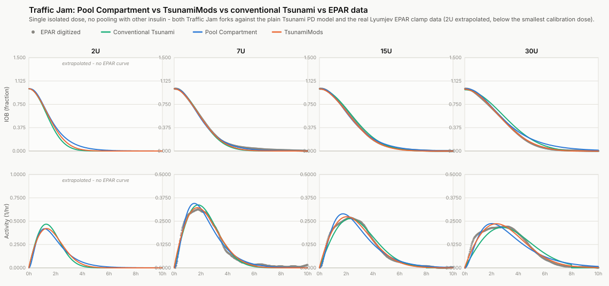
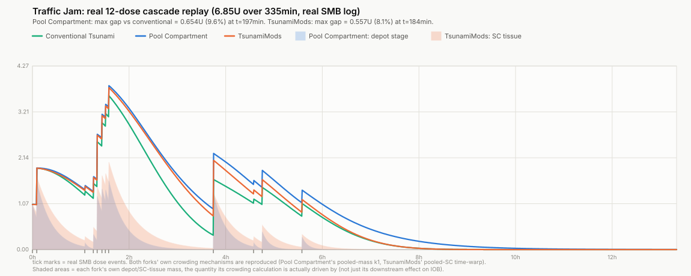

# Traffic Jam insulin model (this fork: Pool Compartment)

This is the "Lyumjev U100 (Tsunami Traffic Jam)" insulin model, built around one idea: insulin sitting under the skin doesn't all absorb at the same fixed speed. The more of it is, the slower it is absorbed. A series of SMBs slows down the absorption of all previous unabsorbed doses, not just the new dose.

There's another implementation of this idea on branch `AAPS_dev_TsunamiMods` (one curve
per dose, rather than the shared tanks below) — see its own README. The present method tackles the problem of activity curve's discontinuity: here activity never jumps, neither when a dose is given nor when the rates are re-evaluated (see below).

Traffic Jam is inspired by piecycle's Tsunami PD model (https://github.com/piecycle/tsunami), which adapts the absorption rate based solely on the individual dose. This branch started as an expansion of that model, but whilst on it, the target PD model itself was changed. That is, the individual activity curve (in the absence of previous doses) isn't the same curve as the plain Tsunami PD models. Traffic Jam's curve was fit independently against the same published Lyumjev absorption data, using a different formula shape. Different formula, different constants. A single dose's activity peaks at about the same time in both (1U: 71 minutes, against 70 for plain Tsunami), and 1 - IOB/dose of 1U reaches 0.9 after 155 minutes, against 150 for plain Tsunami.

## How it works

Every dose (bolus, extended bolus, temp basal delivery) moves through three stages:
**depot** (sitting under the skin, not yet absorbed), **transit** (moving toward
circulation), **active** (in the blood, doing its job, until cleared). A dose adds
straight into the depot, drains through transit into active, then out. Reported IOB is
whatever's left across all three stages; reported activity is how fast the active stage is
being cleared.

The depot and transit stages share one drain rate, and the more insulin sits in the depot, the
slower that rate gets. The active stage drains at a fixed rate (half-life 5.3 minutes) that
nothing changes. The shared rate is re-evaluated at every whole minute and right after every
bolus, from the insulin then in the depot, and held in between. Boluses, SMBs and extended
boluses crowd each other: a cascade of SMBs slows every earlier SMB still in the depot or in
transit (which drains at the depot's rate). Delivered basal crowds only itself, so a basal rate
does not slow the SMBs on top of it. Crowding stays within one infusion site: insulin given
before a cannula/site change never crowds insulin given after it. With the fitted constants
(below) the shared rate is 0.0298 per minute with 0.1U in the depot, 0.0178 with 1U and 0.0116
with 7U.

A new dose goes into the depot, and the depot and transit rate is re-evaluated right after it with
the dose included, so from then on it slows insulin still in the depot or transit. The dose adds
nothing to the active stage, and the active stage's rate is fixed, so the reported activity never
jumps, neither when a dose is given nor when the shared rate is re-evaluated. During an SMB
cascade activity can still dip slightly, as each SMB slows the insulin feeding the active stage:
in the 12-SMB cascade further below, by at most 0.7% of its peak from one minute to the next
(Python replica of the engine).

Profile basal (the true baseline, evaluated as if nothing else was happening) is tracked independently as usual, but following the same mechanism: it crowds only itself, like delivered basal, so with no temp basal running the two evolve identically.

## Absorption rates and the fit

An earlier version crowded only the depot, with transit and the active stage at fixed speeds
(the active stage pinned to lispro's 44-minute serum half-life). Those two fixed stages alone
put a ~95-minute floor under the mean action time of every dose, against ~70 minutes for
TsunamiMods' curve at 0.3U, so small SMBs acted too slowly however fast the depot was. The next
versions crowded depot and transit together and fitted a constant clearance for the active
stage. First the rate was held at its value for the dose's own amount for the whole dose, while
the engine re-evaluates it from the live depot mass; run that way with no basal, those constants
matched the EPAR activity curves with R^2 0.654 / 0.533 / 0.449 at 7 / 15 / 30U. Then the
constants were fitted with the live rate, to the EPAR curves plus TsunamiMods' curves at 0.2,
0.5, 1, 2 and 3.5U (an extrapolation of TsunamiMods' own fit to the 7-30U EPAR data, not
measurements): K1_B0 0.017258, K1_B1 -0.215412, active-stage half-life 1.6 minutes. With basal
counted in the same crowding mass as the SMBs, no such constants fit both the EPAR curves (no
basal infused) and TsunamiMods' small-dose curves placed on top of a basal rate, hence basal
crowding only itself. That was found with those constants; the current constants, fitted to the
EPAR curves alone, have not been tested with basal in the bolus group.

The next version also gave the active stage a crowding-dependent rate of its own (0.0427785 *
A^-0.4966087, A the active mass) and fitted four constants directly to the EPAR curves. Its
activity stepped at every re-evaluation of that rate, and its small doses acted slower than any
earlier version's (table below).

The current version goes back to a fixed active-stage rate, so three fitted constants, and fits
them in two steps to the digitized EPAR clamp curves (Lyumjev 7 / 15 / 30U, no basal insulin
infused). Both steps use curves truncated at 480 minutes: every curve, target and model alike, is
cut at 480 minutes and normalized over 0-480 minutes. Activity is divided by its integral over
0-480 minutes, and IOB is 1 minus the cumulative activity divided by its value at 480 minutes
(1 at 0 minutes, 0 at 480). For the model's isolated single-dose activity a(t) and IOB fraction
S(t), that is a(t) / (1 - S(480)) and (S(t) - S(480)) / (1 - S(480)).

- Step 1: TsunamiMods' Weibull form is fitted to each EPAR dose alone (activity and IOB together,
  each curve's squared errors divided by its total sum of squares). That gives each dose's
  activity peak: 103.3 / 127.3 / 138.5 minutes, height 5.465 / 4.591 / 3.939 thousandths of the
  dose per minute, at 7 / 15 / 30U.
- Step 2: the three constants are fitted, with the shared rate re-evaluated every minute as the
  engine does, to those peaks: the sum over 7 / 15 / 30U of ln^2(model peak time / step-1 peak
  time) + ln^2(model peak height / step-1 peak height), on the model's cut, normalized activity.
  The model's peaks: 104.9 / 122.6 / 141.7 minutes, heights within 0.4% of step 1's.

Fitted (masses in U, rates per minute): depot and transit rate 0.01784168 * M^-0.2224188, M the
depot mass; active-stage rate 0.1297809 (half-life 5.34 minutes). Scored on the EPAR curves
themselves (model sampled at whole minutes, interpolated linearly to the EPAR sample times), the
sum over the 6 curves (activity and IOB at 7 / 15 / 30U) of 1 - R^2 is 0.0672. For comparison,
on the same score: the previous four-constant fit 0.0441; the same three stages with a fixed
active-stage rate fitted directly to that score 0.0558; the fit before that (EPAR plus
TsunamiMods' small-dose curves) 0.0572; TsunamiMods' Weibull form fitted directly to it 0.0582
(a0 69.944 minutes, a1 0.2177, p 1.9017, within 2.0% of TsunamiMods' 70.884 / 0.2134 / 1.9002).
R^2 activity / IOB on the truncated curves: 0.982 / 0.997, 0.988 / 0.999, 0.969 / 0.998 at 7 /
15 / 30U. No curve below 7U is in the fit, so the times below for smaller doses are the fitted
law's extrapolation. Since a dose's rate does not depend on basal, each dose's own curve is the
same on any basal rate.

Minutes until 1 - IOB/dose of an isolated dose reaches 0.5 / 0.9 (nothing else in the system,
absorption speed 1.0, whole curve, not cut at 480 minutes). The first three columns' times hold
on any basal rate; the other columns are each version's own figures with the rate held per dose:

| Dose | Current fit (two steps, fixed active-stage rate) | Previous fit (crowded active stage) | Fit before that (fixed active-stage rate; EPAR plus TsunamiMods' small-dose curves) | Fit with the rate held per dose | Fit to raw EPAR activity alone (rate held per dose) | Depot-only version | TsunamiMods |
|------|---------------------------------------------------|-------------------------------------|---------------------------------------------------------------------------------------|---------------------------------|-----------------------------------------------------|--------------------|-------------|
| 0.1U | 55 / 97                                           | 93 / 206                            | 52 / 96                                                                               | 55 / 114                        | 63 / 158                                            | 81 / 192           | 52 / 97     |
| 0.3U | 68 / 121                                          | 97 / 215                            | 65 / 121                                                                              | 66 / 134                        | 73 / 169                                            | 85 / 195           | 65 / 122    |
| 1U   | 86 / 155                                          | 104 / 225                           | 84 / 155                                                                              | 84 / 167                        | 88 / 191                                            | 93 / 204           | 84 / 158    |
| 3U   | 108 / 195                                         | 114 / 236                           | 106 / 196                                                                             | 105 / 211                       | 108 / 222                                           | 107 / 223          | 106 / 200   |
| 5U   | 120 / 217                                         | 122 / 242                           | 118 / 219                                                                             | 118 / 238                       | 120 / 243                                           | 116 / 239          | 119 / 223   |

The current fit's 90% time is 1.76-1.81 times its 50% time at these doses, against 1.88 for
TsunamiMods' curve. The engine drops a dose 480 minutes after it is given. At absorption speed
1.0, at most 1.1e-8% of a dose up to 7U and 0.09% of a 30U dose are still on board by then; at
absorption speed 0.5, 0.009% of a 1U dose, 1.9% of 3U and 4.9% of 5U.

A Python replica of the engine without its 480-minute window (equal to the engine's Kotlin code
run on the JVM within 3.1e-8U of IOB over the first 480 minutes) gives the following. For a
cascade of 12 SMBs totalling 7.85U (0.9, 0.6, 1.3, 0.4, 0.7, 0.5, 0.3, 0.8, 0.5, 0.4, 0.55 and
0.9U at minutes 0, 10, 20, 35, 45, 60, 75, 90, 105, 120, 140 and 160; not the 6.85U device-log
sequence further below), the cascade's IOB exceeds the sum of the SMBs' separate IOB
contributions by up to 23.2% of 7.85U, and its delivered insulin minus IOB reaches 50% / 90% of
7.85U 46.5 / 68.9 minutes later than for the same SMBs computed one at a time and summed, on any
basal rate (previous fit: 9.7% and 22.8 / 23.7 minutes). A basal rate started with no insulin on
board (rate/60 U delivered at the end of every minute) reaches 50% / 90% of its steady-state
activity after 81 / 196 minutes at 0.5 U/h and 96 / 237 minutes at 1 U/h (previous fit: 106 /
246 and 113 / 262).

The plots below were generated with the depot-only version's constants and have not been
regenerated yet.

Single isolated doses, nothing else in the system: 2U (extrapolated, no EPAR reference)
and 7U/15U/30U at the actual EPAR calibration points, now alongside `AAPS_dev_TsunamiMods`'
own curve so the two forks can be compared directly, not just against conventional Tsunami
and the real data.

## Per-patient absorption speed

A preference (Insulin settings → Absorption Speed, `DoubleKey.InsulinTrafficJamSpeedMultiplier`,
range 0.2-5.0, default 1.0) multiplies the shared depot/transit rate: 2.0 makes insulin leave the
depot and transit twice as fast as standard, 0.5 half as fast. Peak activity moves by less,
because the active stage is not scaled: a 1U dose's activity peaks after 40 minutes at 2.0, 71 at
1.0 and 134 at 0.5. It's a direct multiplier applied as-is, not a derived "effective
DIA" or other indirect framing, since this model's decay is dose-dependent (crowding) and
asymptotic, so no single duration number would actually be dose-independent or exact.

The active stage's rate is deliberately never multiplied by this knob, since the knob describes
the injection site. At 2.0, 1 - IOB/dose of a 1U dose reaches 0.5 / 0.9 after 47 / 82 minutes
(default: 86 / 155); at 0.5, after 165 / 300.

At the default 1.0, this is an exact no-op: the depot/transit rate is multiplied by `1.0` (the
active stage's rate is never multiplied), which is
bit-for-bit identical to the unscaled rate, so the default behaves exactly like the fit
described above with no knob present at all.

## Real multi-dose behavior

(Numbers in this section are for the depot-only version's constants.) Replaying a real 6.85U/12-SMB sequence from an actual device log (each fork's own
crowding mechanism included — this fork's pooled-depot rate, TsunamiMods' pooled-SC
time-warp) against the plain Tsunami model as a reference: this fork reaches a peak gap of
0.654U (9.6% of the total dose delivered) around 3.3h into the sequence, versus 0.557U
(8.1%) for TsunamiMods over the same replay. Both forks report meaningfully more IOB than
plain Tsunami would during a run of stacked SMBs; this fork's gap is still the larger of
the two, though the earlier widened refit brought it much closer to TsunamiMods' own
(previously 13.7% before that refit). Neither gap should be closed by preemptively raising
basal — it reflects the crowding model doing its job, not an error — but it's worth
knowing which fork is the gentler transition if switching between them.
