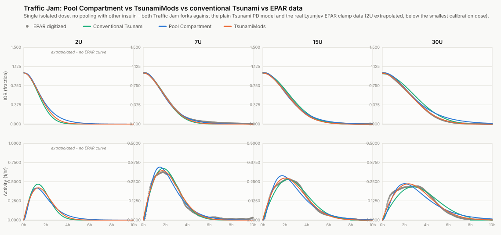

# Traffic Jam insulin model (this fork: Pool Compartment)

This is the "Lyumjev U100 (Tsunami Traffic Jam)" insulin model, built around one idea: insulin sitting under the skin doesn't all absorb at the same fixed speed. The more of it is, the slower it is absorbed. A series of SMBs slows down the absorption of all previous unabsorbed doses, not just the new dose.

There's another implementation of this idea on branch `AAPS_dev_TsunamiMods` (one curve
per dose, rather than the shared tanks below) — see its own README. The present method tackles the problem of activity curve's discontinuity: here activity never jumps, neither when a dose is given nor when the rates are re-evaluated (see below).

Traffic Jam is inspired by piecycle's Tsunami PD model (https://github.com/piecycle/tsunami), which adapts the absorption rate based solely on the individual dose. This branch started as an expansion of that model, but the target curve itself has since changed: the current constants are fitted to a pump study's serum insulin, not to clamp activity curves (see "Absorption rates and the fit"). On a settled pump site the depot is fast (half-life about 6 minutes with 1U in it), so most of a dose's timing comes from its time in the blood (half-life 51.5 minutes) and the delay to its effect (8 minutes), and crowding adds minutes, not hours, to an SMB cascade. A lone 1U bolus's activity peaks at 45 minutes with the default 8-minute CGM lag (34 without), and 1 - IOB/dose reaches 0.9 after 199 minutes (191 without).

## How it works

Every dose (bolus, extended bolus, temp basal delivery) moves through three stages: the **depot**
(under the skin at the infusion site, not yet absorbed), **plasma** (insulin in the blood) and
**effect** (insulin effect still to come), and with a CGM lag set (the default) a fourth, the effect
the CGM has yet to show. A dose adds straight into the depot and moves down the chain; a bolus or
SMB enters as the pump gives it, in small pulses (see "Micro-doses"). Reported IOB is whatever's
left across all stages; reported activity is the rate at which the last stage empties.

Only the depot crowds: the more insulin sits in it, the slower it empties. Plasma (half-life 51.5
minutes) and effect (half-life 8 minutes) are the body's and drain at fixed rates that nothing
changes, not even the speed setting. The depot's rate is re-evaluated at every whole minute and
right after every bolus (at the bolus's site), from the insulin then in the depot, and held in
between. Boluses, SMBs,
extended boluses and delivered basal (the profile rate, temp basals and zero temps alike) crowd
each other: a cascade of SMBs slows every earlier SMB still in the depot, and a basal rate slows the
doses given on top of it. Crowding stays within one infusion site: insulin given before a
cannula/site change never crowds insulin given after it. How strongly doses crowd each other is a
setting, the dose interaction (see "Dose interaction" below); at its default of 1 they all share one
rate, as described here. With the fitted constants (below) the depot's rate on a settled site is
0.239 per minute with 0.1U in the depot (half-life 2.9 minutes), 0.114 with 1U (6.1 minutes) and
0.0542 with 10U (12.8 minutes).

A new infusion site absorbs more slowly: at the new-site speed (0.47 by default) right after the
change, rising to full speed over the new-site ramp, 48 hours by default (see "Site age" below).

A new dose goes into the depot, and the depot's rate is re-evaluated right after it with the dose
included, so from then on it slows insulin still in the depot. The dose adds nothing to the later
stages, whose rates are fixed, so the reported activity never jumps, neither when a dose is given
nor when the depot's rate is re-evaluated. During an SMB cascade activity can still dip slightly, as
each SMB slows the insulin leaving the depot: in the 12-SMB cascade further below, by at most 0.36%
of its peak from one minute to the next (Python replica of the engine).

Profile basal (the true baseline, evaluated as if nothing else was happening) is tracked independently as usual, following the same mechanism among its own doses only: each minute of profile basal interacts with the rest of the profile basal by the dose interaction value (see below), never with delivered insulin, so with no temp basal and no other insulin running it evolves identically to delivered basal, and it is the same every day for the same profile. The IOB the loop uses (bolus IOB + net basal IOB) is total IOB minus profile basal IOB, where total IOB is all insulin on board at the site (boluses, SMBs, extended boluses and delivered basal), computed every minute as above. Above a dose interaction of 0, boluses, SMBs and extended boluses also slow the delivered basal; the basal they hold back is part of total IOB, and AAPS shows it under net basal IOB even with no temp running. The zero-temp IOB used for the zero-temp prediction is the same difference from a run with delivered basal stopped one minute from now, IOB and activity both.

## Absorption rates and the fit

The depot's rate law and the plasma stage are fitted to the pump study in the EMA's Lyumjev
assessment report (EMA/86760/2020, study ITSC) alone: serum insulin lispro, digitized from figures 17
and 18, after a breakfast bolus on a MiniMed 640G with the basal running, on day 1 and day 3 of one
3-day infusion set, as a single-wave bolus (1.5 U/min) and a dual-wave one (half at 1.5 U/min, half
over 3 hours). The pump's delivery is replayed as it was given: the bolus in 0.05U pulses, a minute
of pulses at a time, and the basal and the square wave a dose a minute, all of it in one depot (dose
interaction 1, as insulin from one cannula pools). Serum is taken as proportional to the plasma
stage, with one scale for all four curves. The report doesn't give the bolus size; 10U is assumed.

Fitted (masses in U, rates per minute): depot rate 0.11391363 * D^-0.32231826 on a day-3 site, D
the depot mass, the plasma half-life 51.5 minutes, and day 1 at 0.47 times day 3's speed. R^2: 0.993
/ 0.986 on day 1 (single / dual wave), 0.983 / 0.972 on day 3. The previous constants held the plasma
half-life at the published 44 minutes (depot rate 0.08736466 * D^-0.25557946, day 1 at 0.4915), which
fits these curves worse: R^2 0.994 / 0.987 on day 1 but 0.974 / 0.970 on day 3; the four fall short of
1 by 0.075 in all, against 0.066 now. Held at 5 minutes instead, the plasma stage fits them much worse
(R^2 0.82-0.96). Assuming a 6U or 15U bolus instead of 10U moves the crowding exponent to -0.36 or
-0.28 and day 1 to 0.49 or 0.44 of day 3, and leaves the plasma half-life at 51-52 minutes.

The effect stage is the delay from insulin in the blood to its effect. The report has three studies
that measured serum insulin and the glucose infusion rate in the same people. Fitted directly from the
measured serum (no absorption model), the infusion rate trails serum with a half-life of 24 minutes in
young adults with type 1 diabetes (study ITRR, 15U; R^2 0.98; a delay of 1-10 minutes fits with R^2
0.49-0.80 only) and 34-45 minutes in healthy subjects (ITSH, 7/15/30U, and ITRT), whose infusion
rate also saturates: one saturating link fits ITSH's three doses together (R^2 0.97-0.98), a linear
one doesn't (0.68-0.87). The clamp's infusion rate is itself set by an algorithm reacting to measured
glucose, so it trails the insulin's effect. The 8 minutes is the half-life that explained a month of
real-world closed-loop pump and CGM data best, with the absorption above, its site age, dose
interaction 1 and an 8-minute CGM lag, scanned from 2 to 32 minutes.

Other structures were tested against the same curves and the same month. A depot that absorbs part of
every dose without crowding fits the pump curves slightly better (R^2 0.993 / 0.986 / 0.985 / 0.980)
but explained the month less well than the fitted plasma stage. Two effect stages in parallel, a fast
and a slow one, fit all three clamp studies' infusion rates better than one stage (ITRR: R^2 0.987
against 0.982), with 20-28% of the effect in the fast stage; that split explained the month much
worse. A split fitted to the month itself (about 75% fast, the slow stage's half-life about 75
minutes) explained it better than one stage, but contradicts the clamp studies and adds two settings,
so the model keeps one depot and one effect stage.

Minutes until 1 - IOB/dose of a lone bolus reaches 0.5 / 0.9, and its activity peak (nothing else in
the system, no basal, absorption speed 1.0, a settled site, the default dose interaction of 1, the
bolus in 0.05U pulses at 1.5 U/min, whole curve). The last two columns are earlier fits': the plasma
stage held at 44 minutes (the previous constants, with the default CGM lag and the same pulses), and
the clamp fit before it (crowded depot and transit, a 5.3-minute active stage, fitted to the report's
clamp activity curves; no CGM lag, the bolus whole):

| Dose | No CGM lag | CGM lag 8 minutes (default) | Plasma at 44 minutes, lag 8 | Clamp fit |
|------|------------|-----------------------------|-----------------------------|-----------|
| 0.1U | 67 / 187, peak 29 | 76 / 195, peak 40 | 70 / 173, peak 41 | 55 / 97 |
| 0.3U | 69 / 188, peak 31 | 77 / 197, peak 42 | 72 / 175, peak 43 | 68 / 121 |
| 1U   | 71 / 191, peak 34 | 80 / 199, peak 45 | 75 / 177, peak 47 | 86 / 155 |
| 3U   | 75 / 194, peak 39 | 83 / 203, peak 49 | 79 / 181, peak 52 | 108 / 195 |
| 5U   | 77 / 197, peak 43 | 86 / 205, peak 52 | 81 / 184, peak 55 | 120 / 217 |

The clamp fits used the clamp curves of 7, 15 and 30U injections, normalized to unit area. Those
curves come from healthy subjects, whose glucose infusion rate saturates (above), so the 30U curve
looked broad and slow, and the fits read that as crowding: small doses came out much faster than
large ones. Serum insulin shows much less dependence on the dose. Their constants, for reference:
depot and transit 0.01784168 * M^-0.2224188, active stage 0.1297809 (the last of them);
before that a crowded active stage (K1_B0 0.01617986, K1_B1 -0.03676295, KE_E0 0.0427785, KE_E1
-0.4966087), EPAR plus TsunamiMods' small-dose curves (0.017258, -0.215412, KE 0.4389397), the rate
held per dose (0.032072, -0.303093, KE 0.0315818; raw EPAR 0.044874, -0.339993, KE 0.0170232), and a
depot-only version (0.069092 * M^-0.596593, K2 0.031796, KE ln(2)/44).

The engine drops a dose 480 minutes after it is given. With the default 8-minute CGM lag, 0.23% of
a 1U bolus and 0.31% of 30U are still on board by then at speed 1 on a settled site; 0.25-0.45% at
speed 0.5 or on a new site; 0.32-1.09% at speed 0.5 on a new site. Only at the lowest settings does
it matter: at speed 0.2 with a new-site speed of 0.2, 4.5% of 1U and 44% of 30U.

The plots below were generated with the depot-only version's constants and have not been
regenerated yet.

Single isolated doses, nothing else in the system: 2U (extrapolated, no EPAR reference)
and 7U/15U/30U at the actual EPAR calibration points, now alongside `AAPS_dev_TsunamiMods`'
own curve so the two forks can be compared directly, not just against conventional Tsunami
and the real data.

## Per-patient absorption speed

A preference (Insulin settings → Absorption Speed, New Site Speed and Ramp, Dose Interaction, CGM Lag, Pulse Size and Bolus Speed → Absorption Speed,
`DoubleKey.InsulinTrafficJamSpeedMultiplier`, range 0.2-5.0, default 1.0) multiplies the depot's
rate: the absorption from the site. Plasma and effect are the body's and stay as fitted, so 2.0 makes
the site absorb twice as fast but doesn't halve a dose's whole action time. At 1.0 the site absorbs as
the pump study's did on day 3 of the infusion set. It's a direct multiplier applied as-is.

## Site age

A preference (Insulin settings → Absorption Speed, New Site Speed and Ramp, Dose Interaction, CGM Lag, Pulse Size and Bolus Speed → New Site Speed,
`DoubleKey.InsulinTrafficJamSiteStartSpeed`, range 0.2-1.0, default 0.47) sets how fast a new
infusion site absorbs, as a share of a settled site's speed. Right after a cannula/site change
(`TE.Type.CANNULA_CHANGE`) the site absorbs at this share of the absorption speed, rising linearly to
the full absorption speed over the new-site ramp: the pump study's day 1 against its day 3, two days
apart, by default. 1.0 turns it off.

Another preference (Insulin settings → Absorption Speed, New Site Speed and Ramp, Dose Interaction, CGM Lag, Pulse Size and Bolus Speed → New Site Ramp,
`DoubleKey.InsulinTrafficJamSiteRamp`, range 1-168 hours, default 48) sets the ramp: how many hours a
new site takes to reach the full absorption speed, how long the pump takes to settle the area. 48 is
the pump study's day 1 to its day 3.

A bolus given right at a site change, with the defaults, no basal: 1U reaches 1 - IOB/dose of 0.5 /
0.9 after 88 / 207 minutes and peaks at 56 (24 hours after the change 82 / 202 and 48; settled 80 /
199 and 45); 3U 95 / 215 and 65 (87 / 207 and 54; settled 83 / 203 and 49).

Every site is independent of the others. Insulin given before a cannula/site change stays at the old
site: it never crowds insulin given after the change, nor is crowded by it, and keeps absorbing at the
old site's own speed (on the old site's own ramp, if that was still running); the ramp starts only
for the new site and only the insulin given to it. A bolus belongs to the site in use when it starts,
even if a site change is logged while its pulses are still being given. Between whole minutes only the
site given insulin has its rate re-evaluated, so one site's doses don't even change the steps in which
another site's insulin is computed: the insulin of the two sites is the sum of each alone, to
rounding (SiteChangeTest). Priming boluses, which fill the cannula or the tubing, are never insulin on board, as
in AAPS's own calculator, though they still count as the last bolus for the SMB interval.

The engine loads site changes from a week (the longest ramp) before the records it reads, so the age
of the site in use at the start of every window is known. Below a dose interaction of 1, a dose's
individual branch absorbs at its site's speed when the dose is given, its age factor rounded to 0.01
(a new site's ramp then needs about 50 isolated curves per amount, not one per minute). The insulin
plugin's own single-dose curve doesn't know the site and shows a settled one.

A month of closed-loop data was also checked for insulin that a site stops absorbing late in its life.
Slowing every site down from a fixed age (72 or 96 hours) fitted the glucose data worse, so the model
has no such rule; a failing site shows up as unexplained rises, which the loop's sensitivity detection
handles.

## Dose interaction

A second preference (Insulin settings → Absorption Speed, New Site Speed and Ramp, Dose Interaction, CGM
Lag, Pulse Size and Bolus Speed → Dose Interaction, `DoubleKey.InsulinTrafficJamMixing`, range 0-1,
default 1.0) sets the share of every dose that absorbs together with all insulin at the injection
site. Every delivery is one dose: each pulse of a bolus or SMB (see "Micro-doses"), and each
minute's delivered basal (profile rate, temp basals, zero temps and temps faked by extended
boluses), extended bolus and profile basal. Each dose is split into two branches, each a depot →
plasma → effect chain:

- a shared branch, value × the dose, absorbing with the shared branches of all other doses of its
  group (all delivered insulin, or, for the profile baseline, all profile basal). Its rate follows
  the group's whole depot mass as if all of that insulin were in the shared branches, so together
  they are value × the one shared pool fitted above.
- an individual branch, (1 - value) × the dose, absorbing on its own. Its rate follows its own depot
  mass as if the whole dose were in it, so it is (1 - value) × the dose's isolated curve, which
  depends on the amount and the site's speed and is computed once per amount and speed and kept in
  memory.

So every IOB and activity is value × its value at 1 plus (1 - value) × the doses' isolated curves
summed, and a dose with no other insulin on board follows the fitted curve at every value (a bolus,
being many pulses, does not). At 0 the feature is off: no dose interacts with any other, each absorbs
as an isolated dose of its own size (a minute of basal as a dose of rate/60 U, a pulse as a dose of the
pulse size), and a cascade is exactly the sum of its SMBs' pulses' isolated curves on any basal
rate. At 1 all insulin follows the same path: the one shared pool, as fitted to
the pump study, where all insulin from the one cannula is in one depot.

A cascade of 12 SMBs totalling 7.85U (0.9, 0.6, 1.3, 0.4, 0.7, 0.5, 0.3, 0.8, 0.5, 0.4, 0.55 and 0.9U
at minutes 0, 10, 20, 35, 45, 60, 75, 90, 105, 120, 140 and 160; Python replica, default 8-minute CGM
lag, settled site, each SMB in 0.05U pulses at 1.5 U/min): minutes by which its delivered insulin
minus IOB reaches 50% / 90% of 7.85U later than at a dose interaction of 0 with no basal, where every
pulse absorbs alone (159.7 / 281.9 minutes), and the largest excess of its IOB over that. At a dose
interaction of 1 the previous constants (plasma at 44 minutes) gave 0.19 / 5.19 minutes and 2.75%
with the same pulses; the clamp fit, with depot and transit crowded, gave 46.5 / 68.9 minutes and
23.2% against the same SMBs taken whole, one at a time:

| Dose interaction | No basal: delay at 50% / 90% | Largest extra IOB | On 0.5 U/h | On 1 U/h |
|---|---|---|---|---|
| 1 (default) | 0.13 / 3.80 | 1.92% of 7.85U | 0.17 / 4.88 | 0.20 / 5.78 |
| 0.5 | 0.07 / 1.92 | 0.96% | 0.08 / 2.48 | 0.10 / 2.94 |
| 0.3 | 0.04 / 1.16 | 0.58% | 0.05 / 1.50 | 0.06 / 1.78 |
| 0.1 | 0.01 / 0.39 | 0.19% | | |
| 0 | 0 / 0 | 0% | 0 / 0 | 0 / 0 |

A single bolus on a steady basal rate, minutes until 1 - (its own IOB)/dose reaches 0.5 / 0.9 (DI:
dose interaction; Python replica, default 8-minute CGM lag, settled site, the bolus in 0.05U pulses
at 1.5 U/min; with no basal at DI 1 as in the table further above, and at DI 0 the same on any basal
rate):

| Dose | DI 1, 0.5 U/h | DI 1, 1 U/h | DI 0.5, 0.5 U/h | DI 0.5, 1 U/h | DI 0.3, 0.5 U/h | DI 0.3, 1 U/h | DI 0, any basal |
|---|---|---|---|---|---|---|---|
| 0.1U | 77 / 197 | 79 / 198 | 76 / 196 | 77 / 197 | 76 / 195 | 76 / 196 | 75 / 195 |
| 0.3U | 78 / 198 | 79 / 199 | 77 / 197 | 77 / 197 | 76 / 196 | 76 / 196 | 75 / 195 |
| 1U | 81 / 200 | 81 / 201 | 78 / 198 | 78 / 198 | 77 / 197 | 77 / 197 | 75 / 195 |
| 3U | 84 / 204 | 84 / 204 | 80 / 200 | 80 / 200 | 78 / 198 | 79 / 198 | 76 / 196 |
| 5U | 86 / 206 | 87 / 206 | 82 / 201 | 82 / 202 | 80 / 199 | 80 / 200 | 77 / 196 |

At the default dose interaction of 1, a basal rate started with no insulin on board (rate/60 U
delivered at the end of every minute) reaches 50% / 90% of its steady-state activity after 76 / 196
minutes at 0.5 U/h and 77 / 197 minutes at 1 U/h.

Below 1 the shared branches are the engine run at 1, one pool per category for all doses, and the
individual branches come from each amount's isolated curve, tabulated once on a 1-minute grid (the
table the bolus snooze uses) and kept in memory. Basal is one dose every minute, so the individual
branches are summed as runs of equal doses a minute apart, one per stretch at one rate: a run's sum is
a difference of the curve's running sums. Past the table's 600 minutes the rate is held, and a run's
sum there is a geometric series of one-minute steps, two steps however long the run. Requests that
keep falling at the same fraction of a minute, like the SMB IOB array's (now, now + 5 minutes, ...),
also get the curves tabulated shifted by that fraction. All of it equals the dose-by-dose sum to
rounding.

Every requested time is simulated over its own window, 480 minutes back to that time, and evaluated
there only. One loop run's SMB IOB array, 95 requests (now to now + 235 minutes, with and without a
zero temp, 8-minute CGM lag), takes about 36 ms at a dose interaction of 1 and 49 ms at 0.55 on two
days of closed-loop history (JVM on the cloud test machine, not a phone; the previous constants, timed
on the same machine: 31-43 ms). Before the windows were per request, every request simulated on to 8
hours past the present, evaluating some 190 other times along the way to fill a cache those requests
never hit, and summed the individual branches dose by dose: 530 ms at 0.5, 53 ms at 1.

The windows read the treatment history (boluses, temp basals, extended boluses, site changes) and
the profile basal of every minute. Each calculation run asks for about a thousand windows (autosens
and the IOB graph at every 5-minute time over a day, the SMB IOB arrays, the overview), every minute
with a 1-minute CGM, and each window used to query the database itself: four queries, and a profile
lookup for every one of its 480 minutes. The engine now loads the history once per calculation run,
for 48 hours back to 12 hours ahead (site changes from a week before that, the longest site ramp,
for the site's age), looks each minute's profile basal up once, and cuts every window's records from
that (the history browser gets a separate load around the day it shows). Any change to that history
(a bolus, temp basal, extended bolus, profile switch or site change) drops the loaded records the
moment it is saved. The database queries of a calculation run go from about 3000 to 4.

## CGM lag

A CGM measures interstitial glucose, which trails the blood by several minutes, and the sensor's own
smoothing adds more. AAPS compares the CGM's rate of change with the insulin's expected effect
(deviation = CGM delta - BGI), so with the effect computed in blood time, every SMB's effect is
counted before the CGM can show it. That reads as a rise unexplained by insulin, which invites the
next SMB. The tail of each dose shows the opposite error.

A preference (Insulin settings → Absorption Speed, New Site Speed and Ramp, Dose Interaction, CGM Lag, Pulse Size and Bolus Speed → CGM Lag,
`DoubleKey.InsulinTrafficJamCgmLag`, range 0-30 minutes, default 8) adds a stage C after the effect
stage, at the fixed rate kc = 1/lag:

    dC/dt = K_EFFECT*A - kc*C,   activity = kc*C,   IOB = D + X + A + C

Every dose's activity is then delayed and smoothed by about the lag, to when the CGM can see it,
and C, effect that has happened in the blood but not yet on the CGM, counts as insulin on board. A
dose's total effect is unchanged. A lone 1U bolus's activity peaks at 34 minutes with no lag, 40 at 5
minutes, 45 at 8 and 50 at 12 (Python replica). Insulin still enters the depot at its real time, so
crowding, treatment times and the SMB interval are untouched. The lag is the sensor's, not the
insulin's, so the speed setting doesn't scale it. The default of 8 minutes is the lag the effect
stage was fitted with (see "Absorption rates and the fit"); 0 removes the stage.

`TrafficJamChain` advances the whole chain in closed form, one step for all four stages, for any
rates. Every term is a divided difference of exp(-x) at the scaled rates: two rates closer than 0.01
(times the step) by exp(-c) sinh(h) / h, three or four within 0.05 by a short series, otherwise by
splitting on the extreme rates. That matters because the depot's rate varies continuously and crosses
the plasma, effect and CGM rates, and a lag of 1/K_EFFECT (11.5 minutes) puts the CGM rate on the
effect rate. Against a 60-digit matrix exponential, from 0.0001 to 600 minutes with rates coinciding
to 1e-13, the relative error is at most 5e-12 (the unit test checks 1e-10). A step costs three
exp() calls, four with the lag, and some arithmetic.

## Micro-doses

A pump doesn't give a bolus all at once. It gives it in small pulses at its bolus speed: at 1.5 U/min,
a 0.05 U pulse every 2 seconds. The engine models every bolus and SMB that way, as the absorption fit
replays the pump study's boluses, with two settings (Insulin settings → Absorption Speed, New Site
Speed and Ramp, Dose Interaction, CGM Lag, Pulse Size and Bolus Speed): the pulse size
(`DoubleKey.InsulinTrafficJamPulseSize`, 0.01-1 U, default 0.05) and the bolus speed
(`DoubleKey.InsulinTrafficJamBolusSpeed`, 0.1-10 U/min, default 1.5, the standard bolus speed in the
EPAR's pump study; AAPS's Medtrum driver expects 1 U/min). Basal, temp basals and extended boluses stay
one dose a minute. This used to be a switch, off by default; the absorption fit and the effect stage
both assume the pulses, so it no longer is.

Each pulse is a dose of its own, split by the dose interaction like any other. Its shared branch joins
the pool, so at a dose interaction of 1 a bolus enters over its delivery time. Its individual branch
absorbs as a lone dose of the pulse size, so below 1 the individual share of every bolus absorbs as fast
as a lone pulse, whatever the bolus's size. A lone 3U bolus at speed 1, with the default lag, peaks at
49 minutes at a dose interaction of 1 and at 40 minutes at 0, so a lone bolus depends on the dose
interaction.

The engine takes each minute of pulses together, at the pulses' average time: they enter the shared
pool at once, and their individual branches are that many copies of the pulse's isolated curve, summed
like a basal run. An SMB of up to 1.5U is one such chunk (0.5U at 9 seconds), 6U four of them, at 29,
89, 149 and 209 seconds. Every minute's pulses are given within it, so none moves by more than a minute,
and a bolus costs about what it did as one dose. On two days of closed-loop history, one loop run's SMB
IOB arrays take 36 ms at a dose interaction of 1 and 49 ms at 0.55, as when every bolus was one dose
(37 / 49 ms; JVM on the cloud test machine, not a phone); treating every pulse as a bolus of its own
takes 61-77 ms. Over a month of closed-loop history, at speeds 0.8-1.4 and dose interactions 0.1-1 with an
8-minute CGM lag, the chunked activity stays within 0.004 U/h of the pulse-by-pulse one.

A bolus still counts whole as insulin on board from its timestamp: the pulses still to come are on
board but not yet active. Some pump drivers record a bolus as it starts (AAPS's Medtrum driver does, with
the full amount), so a loop run during a long bolus still counts all of it. The bolus snooze and the SMB
interval (`lastBolusTime`) use the bolus as recorded. The insulin plugin's own single-dose curve (its
graph, and each treatment's IOB in the treatments list) gives a bolus the same pulses, at the dose
interaction set, and matches the engine for a lone bolus on a settled site given at a whole minute: its
activity to rounding, its IOB less the 0.23-0.31% still on board at the 480-minute horizon, which the curve
subtracts so that it ends at 0 there.

## The activity monitor's multiplier on the profile basal

AutoISF's activity monitor multiplies the profile basal rate: below 1 while it counts steps (e.g. 0.7),
above 1 while it detects inactivity. The loop then knows the profile basal as the profile rate times
that multiplier and sets temp basals around it. The engine used to count basal against the plain
profile, so as soon as the multiplier was gone the loop no longer knew it: an hour at 0.7 on a 1 U/h
profile, with the loop delivering 0.7 U/h, showed -0.30 U of basal IOB at its end and -0.12 U two hours
later, which the loop then made up for.

Each AutoISF run now records the multiplier it applied (`ActivityMultiplierHistory`, kept in the
preferences for two days; the activity ratio whenever `determine_basal` applied it, for activity or
inactivity, unless a high or low temp target set the ratio instead). A run's multiplier holds until
the next run, or for 30 minutes if none follows. For every past minute it covers, the engine takes
profile basal x multiplier as that minute's profile basal, now and later: it is the profile baseline,
and the autosens-adjusted one too, since the activity multiplier replaced the autosens ratio then. The
delivered basal counts against it whatever the loop chose to deliver: the hour above leaves 0 U, during
and after it; a 20-minute zero temp inside it leaves the 0.7 U/h it withheld for those 20 minutes
(-0.24 U); a loop that delivered the plain profile rate anyway shows the 0.3 U/h above the lowered
profile basal as insulin on board (+0.30 U). The future minutes of the IOB arrays and of the zero-temp
projection keep the plain profile rate. This acts in the Traffic Jam engine only; the stock calculator
used by the other insulin models is unchanged.

## Real multi-dose behavior

(Numbers in this section are for the depot-only version's constants.) Replaying a real 6.85U/12-SMB sequence from an actual device log (each fork's own
crowding mechanism included — this fork's pooled-depot rate, TsunamiMods' pooled-SC
time-warp) against the plain Tsunami model as a reference: this fork reaches a peak gap of
0.654U (9.6% of the total dose delivered) around 3.3h into the sequence, versus 0.557U
(8.1%) for TsunamiMods over the same replay. Both forks report meaningfully more IOB than
plain Tsunami would during a run of stacked SMBs; this fork's gap is still the larger of
the two, though the earlier widened refit brought it much closer to TsunamiMods' own
(previously 13.7% before that refit). Neither gap should be closed by preemptively raising
basal — it reflects the crowding model doing its job, not an error — but it's worth
knowing which fork is the gentler transition if switching between them.
